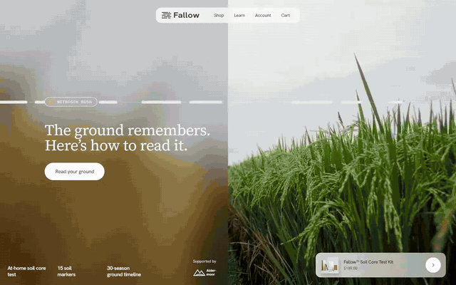

# Fallow

Fallow adalah toko online fiktif untuk **kit uji inti tanah (soil core) rumahan**. Pembeli memutar satu inti tanah sedalam 30 cm dari kebunnya, mengirimnya ke lab, lalu menerima laporan 15 penanda yang dipetakan sepanjang 30 musim. Targetnya pekebun rumahan, penyewa lahan allotment, dan kebun kecil. Situs ini adalah rebuild orisinal yang terinspirasi tata letak dan perilaku sebuah situs referensi. Produk, brand, copy, gambar, dan kodenya dibuat baru.

## Halaman (47)

| File | Isi |
|---|---|
| `index.html` | Home: hero video terbelah, teks muncul per huruf saat scroll, carousel, cara kerja, pendiri |
| `test.html` | Produk: galeri + lightbox, pilihan paket, explorer penanda, isi kit, perbandingan, FAQ, ulasan |
| `what-we-test.html` | 15 penanda dalam tiga layar penuh dengan transisi topeng oval |
| `science.html` | Profil tanah, enam langkah lab, angka riset, FAQ |
| `report.html` | Panduan membaca laporan |
| `ground-score.html` | Cara skor dihitung (kartu kaca bertumpuk) |
| `our-story.html` | Cerita brand dan pendiri (kartu kaca bertumpuk di atas video) |
| `faqs.html`, `contact.html` | FAQ per topik dan formulir kontak |
| `journal.html` | 25 artikel, bisa disaring per topik dan per penanda |
| `podcast.html`, `press.html` | Daftar podcast dan berita |
| `journal/*.html` | 28 halaman artikel |
| `cart.html`, `account.html` | Keranjang dan halaman masuk (tanpa backend) |
| `privacy.html`, `terms.html`, `refund.html`, `data-sharing.html`, `404.html` | Halaman legal dan error |
| `assets/sample-report.pdf` | Contoh laporan (nama dan angka fiktif) |

## Fitur dan interaksi

- Hero: kata mengabur satu per satu saat scroll, panel blur melebar, lalu paragraf terbaca huruf demi huruf.
- Garis timeline berjalan dengan label yang teksnya teracak (scramble) saat berganti.
- Header berpindah dari tengah ke kiri setelah scroll, dropdown "Learn", dan bar produk yang menempel (di mobile muncul dari bawah lalu berhenti di footer).
- Carousel kartu aktif/blur: hover, tombol panah, swipe/drag (mouse dan sentuh), dan geser dua jari di touchpad (satu gerakan = satu slide).
- Cara kerja: gambar menempel dan berganti mengikuti langkah.
- Kartu kaca bertumpuk di `science`, `our-story`, `ground-score`. Topeng oval dan snap di `what-we-test`.
- Akordeon, explorer tab, lightbox, filter dan urutan ulasan, filter jurnal (termasuk state kosong), validasi formulir, keranjang di `localStorage`, dan popup promo (9 detik, sekali per sesi).
- Gradien penutup digambar dengan shader WebGL buatan sendiri. Semua animasi menghormati `prefers-reduced-motion`.
- Situs ini tidak memakai sound, karena referensinya juga tidak (video saja, muted).

## Teknologi

HTML, CSS, dan JavaScript native. Tanpa framework, library, hosting, atau build.

Font: **Hanken Grotesk**, **Source Serif 4**, dan **Geist Mono**, disimpan lokal. Ketiganya menggantikan font komersial di referensi, jadi bentuk hurufnya mendekati, tidak sama.

## Menjalankan

Buka `index.html` di browser.

## Struktur

```
.
├── index.html, test.html, science.html, ... (19 halaman)
├── journal/            28 artikel
├── css/style.css
├── js/site.js
├── assets/
│   ├── fonts/          3 file woff2
│   ├── img/            gambar + favicon.svg
│   ├── video/          hero.mp4, hero-mobile.mp4, story.mp4
│   └── sample-report.pdf
├── docs/preview/       homepage.gif, hero.png
└── README.md
```

## Mengedit

Edit langsung file finalnya, tidak ada generator.

- **Teks:** di file HTML masing-masing. Header, bar produk, popup, dan footer diulang di tiap halaman, jadi ubah dengan cari-ganti di semua file.
- **Warna, font:** CSS variables di `:root`, bagian 1 `css/style.css` (bagian lain bernomor di komentar atas file).
- **Gambar dan video:** timpa file di `assets/` dengan nama yang sama. Label di atas gambar, grafik batang, dan kartu laporan adalah HTML, bukan gambar.
- **Harga:** angka tampil di HTML, angka keranjang di `PLANS` dalam `js/site.js`.
- **Label timeline:** atribut `data-labels` pada `.ptl`.
- **Popup:** jeda 9000 ms di `js/site.js`.
- **Artikel baru:** salin satu file di `journal/`, lalu tambahkan `<article>` di `journal.html` dengan `data-topic` dan `data-el`.

## Yang perlu diganti

- Brand "Fallow", "Stratum Lab", "Aldermoor", "National Plot Survey", "Dr Maren Adeyo", dan tanda tangannya (semua fiktif).
- `hello@fallow.example`, `press@fallow.example`, telepon 1-555-014-2200, tautan media sosial.
- **Ulasan, rating, dan klaim riset** hanya contoh. Jangan dipublikasikan sebagai testimoni atau klaim nyata.
- Daftar sumber di artikel fiktif. Isi artikel perlu ditinjau ahli sebelum dipakai.
- Teks legal, harga, kode promo FIRSTCORE.
- Formulir, login, dan checkout belum tersambung. Tidak ada data yang dikirim.

## Kredit aset

- **Gambar:** dibuat AI (Nano Banana via Google Flow). Orang di dalamnya fiktif.
- **Video:** [Mixkit](https://mixkit.co/license/), Mixkit Stock Video Free License. Nomor klip: 36984, 9767, 8864, 38373, 35854, 43697, 46563, 45263, 8898, 25915, 47063.
- **Poster video:** `hero-poster.jpg` dan `story-poster.jpg` diambil dari klip Mixkit.
- **Font:** Google Fonts, SIL Open Font License.

## Keterbatasan

- Font pengganti membuat beberapa baris patah di tempat berbeda.
- Shader penutup meniru karakter geraknya, bukan salinan video aslinya.
- Snap di `what-we-test` memakai smooth scroll bawaan browser.
- Ulasan ditulis 8 buah, referensi punya 25.
- `assets/img/sci-3.jpg` belum dipakai di halaman mana pun.
